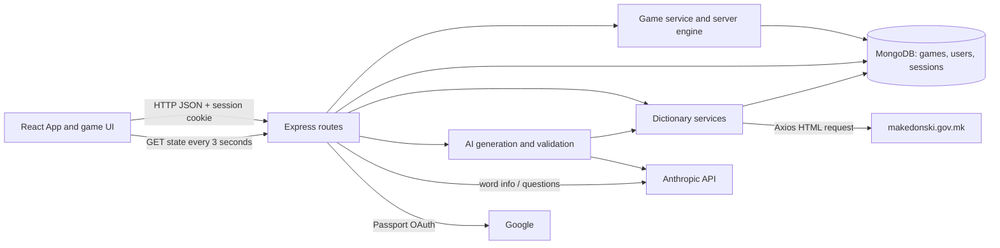

# Македонски Скрабл / Macedonian Scrabble

A bachelor's thesis application for playing a Scrabble-style game with Macedonian Cyrillic tiles. Players sign in with Google, invite another human or play against an AI, challenge words against a dictionary, and explore meanings. Optional language questions and a private vocabulary collection provide educational interactions.

This guide describes the implementation, including differences between reusable engine functions and active routes. It does not establish compliance with an official Scrabble ruleset or demonstrate learning outcomes.

## Contents

- [Project overview](#project-overview)
- [Features and implementation status](#features-and-implementation-status)
- [Technology stack](#technology-stack)
- [Architecture](#architecture)
- [Repository structure](#repository-structure)
- [Game engine and rules](#game-engine-and-rules)
- [Main application flows](#main-application-flows)
- [Backend interfaces](#backend-interfaces)
- [Data and persistence](#data-and-persistence)
- [External services and AI integration](#external-services-and-ai-integration)
- [Local setup](#local-setup)
- [Environment variables](#environment-variables)


## Project overview

The application is intended for Macedonian-speaking word-game players, including learners who want to inspect meanings and revisit unfamiliar words. Its interface is primarily Macedonian. All 31 Macedonian letters have tiles, including Ѓ, Ѕ, Ј, Љ, Њ, Ќ, and Џ; each is a single tile. Frequencies and point values are explicitly configured rather than inherited from an English edition.

The active home screen creates two-player games: one signed-in human and either another human or an AI. Human opponents sign in independently and join by code or `?join=<gameId>` link. Browsers on the same computer still need the backend and MongoDB. There is no connected offline or shared-screen hot-seat mode.

Educational interactions include dictionary definitions after challenges, model-generated word information, bonus language questions in human multiplayer, and **Мој профил → Мој речник**. The personal dictionary collects only words its owner challenged that were found valid with a usable definition; it is not a list of every word the player used.

## Features and implementation status

“Implemented” means a connected code path exists, not that a live external service was verified. “Partial” identifies an integration gap.

| Feature | Status and actual behavior | Main implementation |
| --- | --- | --- |
| Macedonian board and tiles | Implemented: 15×15 board, 100 tiles, seven-tile racks, blanks, score preview, click/drag placement | [Constants](server/game/constants.js), [board](client/src/components/ScrabbleBoard.jsx), [UI](client/src/scrabble.jsx) |
| Human multiplayer | Implemented: authenticated create/join, invitations, waiting screen, three-second HTTP polling | [App](client/src/App.jsx), [invitations](client/src/components/InviteScreen.jsx), [routes](server/routes/games.js) |
| Local multiplayer | Separate local browser sessions can use the online flow; no connected offline/hot-seat mode | [App](client/src/App.jsx), [UI](client/src/scrabble.jsx) |
| AI opponent | Implemented: external suggestions plus local placement search and dictionary checks; browser requests AI turns | [Generation](server/routes/aiMove.js), [hook](client/src/hooks/useAIMove.js) |
| Difficulty levels | Partial: age-dependent prompts exist, but active creation sets age 25; adjustable setup screen is not mounted | [App](client/src/App.jsx), [prompts](server/routes/aiMove.js), [older setup](client/src/components/SetupScreen.jsx) |
| Classic / bonus mode | Implemented for the human-game home option; questions require a move worth more than 10 points | [Home](client/src/components/HomePage.jsx), [routes](server/routes/games.js), [questions](server/services/bonusQuestion.js) |
| Thematic gameplay | No connected theme selector, themed lexicon, or thematic multiplier found; questions concern a played word | [Home](client/src/components/HomePage.jsx), [routes](server/routes/games.js) |
| Placement and scoring | Implemented in engine/UI; server confirmation does not independently enforce all human-move rules | [Engine](server/game/gameEngine.js), [UI](client/src/scrabble.jsx), [routes](server/routes/games.js) |
| Challenges | Implemented: select one formed word; backend resolves the whole move using dictionary verdict. Not automatic checking of every human submission | [Routes](server/routes/games.js), [lookup](server/services/challengeService.js) |
| Rich word information | Implemented AI lookup for meanings, examples, related words, etc.; separate from challenge validation | [Route](server/routes/wordInfo.js), [modal](client/src/components/WordInfoModal.jsx) |
| Google sign-in | Implemented: Passport, MongoDB-backed sessions, logout | [Auth](server/routes/auth.js), [Passport](server/config/passport.js) |
| Personal dictionary | Implemented: private entries, case-insensitive search, expandable history, recovery | [Profile](client/src/components/ProfileView.jsx), [service](server/services/personalDictionary.js) |
| Results and rankings | Implemented: finished games/logs retained, top 100 human rankings aggregated. No dedicated finished-game history browser found | [Game](server/models/Game.js), [routes](server/routes/games.js), [App](client/src/App.jsx) |
| Reconnection | Partial: restore session-stored game ID and persisted state; unsent previews lost; no disconnect timeout/seat replacement | [useGame](client/src/hooks/useGame.js), [UI](client/src/scrabble.jsx) |
| Socket.IO game synchronization | Not implemented: connection/disconnection logging only | [Server](server/app.js) |
| End-game adjustments | Engine implements deductions/record bonuses; inline multiplayer finalization bypasses parts of that logic | [Engine](server/game/gameEngine.js), [routes](server/routes/games.js) |

No separate roadmap was found; improvements below are suggestions, not promised features.

## Technology stack

Resolved versions come from [client/package-lock.json](client/package-lock.json) and [server/package-lock.json](server/package-lock.json). Manifests generally declare caret ranges.

| Technology | Version | Active responsibility and fit |
| --- | --- | --- |
| React / React DOM | Locked 19.2.4 | Component UI and interactive local state |
| Vite | Locked 7.3.1 | Development server, API proxy, frontend bundling |
| React Vite plugin / React Compiler | Manifest `^5.1.1` / `^1.0.0` | JSX integration and configured compiler |
| Tone | Locked 15.1.22 | Synthesized sounds in [soundService](client/src/services/soundService.js) |
| Express | Locked 5.2.1 | HTTP routing and middleware on Node.js with ES modules |
| Mongoose | Locked 9.2.1 | MongoDB schemas, queries, state conversion |
| express-session / connect-mongo | Locked 1.19.0 / 6.0.0 | Session identity with persistent server-side storage |
| Passport / Google OAuth strategy | Locked 0.7.0 / 2.0.0 | Google login and user deserialization |
| Axios / Cheerio | Locked 1.13.5 / 1.2.0 | Fetch and parse dictionary HTML |
| Anthropic SDK | Locked 0.78.0 | AI suggestions, questions, word information |
| nanoid | Locked 5.1.6 | Invitation IDs |
| dotenv | Locked 17.3.1 | Backend environment-file loading |
| Socket.IO | Locked 4.8.3 | Instantiated server, logging only |
| ESLint | Manifest `^9.39.1` | Frontend linting with React hooks rules |

MongoDB is external; its server version is not pinned. `cors` is actively imported and locked at 2.8.6, but **absent from the server manifest's direct dependencies**. Present transitive availability is not a reliable declaration of an application dependency.

`@google/genai` 2.21.0 is declared/locked, but no active import or Gemini call was found. React type packages are development dependencies; source is JavaScript/JSX, not TypeScript. Tests use Node's built-in facilities rather than Jest/Vitest.

## Architecture

Entry chain: [main.jsx](client/src/main.jsx) → [App.jsx](client/src/App.jsx) → [scrabble.jsx](client/src/scrabble.jsx). App coordinates login, home/invitations, profile, rankings, and game selection. `useGame` creates, joins, and restores games; the main game component makes action requests and polls state independently.



**State ownership.** MongoDB's Game document is the durable state exchanged between players. The backend loads, changes, and saves it. React maintains a tentative board, reduced rack, words, score preview, selection/drag state, and dialogs. Normal placement stays local until confirmation; the UI does not send each tile through `/place`. Polling pauses while the current player is placing; applying polled state pauses while a challenge result is displayed.

Server persistence does not imply full server validation. Human `/confirm` accepts board, placements, and numeric score, recomputes formed words, and enters challenge status. It does not invoke `confirmPlacementAction`, recalculate score, or fully validate board/rack ownership. AI has stronger server validation. Returned state includes every rack and the full tile bag; `safeState` hides only a pending question's answer.

There are separate [client](client/src/game/gameEngine.js) and [server](server/game/gameEngine.js) engines, not a shared imported package. The active component also duplicates extraction, validation, and scoring. Comments describing one shared source of truth overstate the arrangement. Multiplayer acceptance/challenge handlers implement inline transitions rather than consistently using the engine.

Acceptance/challenge resolution uses conditional updates keyed by status and `pendingMoveId`. Receipts support challenge retries and dictionary recovery. Other actions, including AI turns, generally use load/modify/save without equivalent concurrency protection.

## Repository structure

```text
scrabble-app/
├── README.md
├── client/
│   ├── package.json, package-lock.json
│   ├── vite.config.js, eslint.config.js, index.html
│   └── src/
│       ├── main.jsx, App.jsx     # Entry and screen coordination
│       ├── scrabble.jsx          # Active UI, previews, polling, actions
│       ├── components/           # Board, rack, home, profile, dialogs, results
│       ├── hooks/                # Authentication, lifecycle, AI requests
│       ├── game/                 # Client constants, state, engine
│       ├── services/             # HTTP wrappers, dictionary helpers, sounds
│       └── test.js               # Engine assertion harness
└── server/
    ├── package.json, package-lock.json
    ├── app.js                    # HTTP, database, sessions, mounts
    ├── config/passport.js
    ├── middleware/requireAuth.js
    ├── routes/                   # Auth, games, AI, lookup, word info
    ├── services/                 # Orchestration, scraping, dictionary, quiz
    ├── models/                   # User, Game, Word, PersonalDictionary
    ├── game/                     # Rules, constants, state, log formatting
    └── test/                     # Multiplayer/browser fixtures and guide
```

Tests also sit beside services and log formatting. Generated content/dependencies are omitted. Older setup/lobby/leaderboard components remain; trace the active screen tree from App rather than inferring availability from filenames.

## Game engine and rules

Sources: [constants](server/game/constants.js), [state](server/game/gameState.js), [engine](server/game/gameEngine.js), [active UI](client/src/scrabble.jsx).

### Board, tiles, and scoring

The board is 15×15 with zero-based coordinates. Opening must cover `(7,7)` and place at least two tiles. Players draw seven tiles. Bag creation uses Fisher–Yates; IDs/shuffling use `Math.random`, without a reproducible seed.

The bag totals **100 tiles**, including two blanks:

| Points | Letters with count |
| --- | --- |
| 0 | ★ ×2 |
| 1 | А ×9, Е ×6 |
| 2 | И ×7, О ×7, Н ×6, Р ×6 |
| 3 | С ×5, Т ×5, У ×4 |
| 4 | В ×4, К ×4, Л ×4 |
| 5 | П ×3 |
| 6 | Г ×2, Д ×3, М ×3 |
| 7 | Б ×2, З ×2, Ј ×2 |
| 8 | Ц ×2, Ч ×2 |
| 9 | Ж ×1, Ф ×1, Ш ×1 |
| 10 | Ѓ ×1, Ѕ ×1, Љ ×1, Њ ×1, Ќ ×1, Џ ×1, Х ×1 |

`BONUS_MAP` defines this application's exact layout; do not assume the standard English layout. `DL`/`TL` multiply a new letter by two/three. `DW`/`TW` multiply the whole word by two/three; center `ST` acts as double word. Word multipliers multiply together. Confirmed tiles do not activate squares again. All newly formed horizontal/vertical words contribute. Seven placed tiles add 50 points.

Blanks retain `letter:"★"` and zero points while `displayLetter` holds a Macedonian letter. UI also stores assignments separately. Normal confirmation sends the board rather than the assignment map, so the map need not capture every UI assignment; extraction reads cell display letters.

### Placement and extraction

New tiles must occupy one row/column without an empty cell between their extremes; existing tiles may bridge the sequence. After opening, a new tile must touch a confirmed tile orthogonally. At least one word of two or more characters must form.

For each placement, `findFormedWords` walks backward then forward horizontally/vertically through contiguous cells, concatenating `displayLetter || letter`. It deduplicates by direction/start. These are geometry checks, not dictionary checks. UI performs them before confirmation; the active server route does not repeat all of them.

### Turns, passes, exchanges, and ending

Turns start at index zero and rotate modulo player count. Skip penalties clear when consumed. Engine finalization adds score, removes placed IDs, refills to seven, confirms board, records longest word/best turn, clears tentative fields, and resets consecutive passes.

Passing returns engine-managed tentative tiles and consumes a turn. Exchange replaces the **entire rack**, costs five points, and consumes a turn. It requires no placements, score ≥5, and bag size ≥7. New tiles are drawn before the old rack is returned/shuffled. Exchanges count as skipped turns for ending.

The engine ends when bag/current rack are empty, or after `players.length * 2` consecutive passes/exchanges. `triggerGameOver` deducts each remaining rack value with a zero floor, then gives +15 to every player tied for longest word and +10 to every player tied for best turn score. It does not transfer opponents' rack values to the player who went out.

**Path-dependent behavior:** inline multiplayer `/finalize` and valid-challenge branches detect empty bag/rack and set `gameOver`, but do not call `triggerGameOver` or update word records. Engine-backed pass, AI, and no-human-opponent finalization use engine adjustments. Record bonuses/deductions therefore differ between paths. Stored `finished` maps to API/engine `gameOver`.

### Challenges and rollback

The active route requires a signed-in human opponent, human author, no AI players, matching `pendingMoveId`, and integer `wordIndex`. Words are recomputed from stored pending tiles/board. Clients cannot select an unrelated word or submit a verdict.

| Outcome | Board, score, rack, and turn |
| --- | --- |
| Selected word valid | Whole move stands. Mover gets stored score, placed IDs leave stored rack, rack refills, board confirms. Challenger gets skip penalty consumed on advancement; in two-player play mover plays again. Only selected word is dictionary-checked. |
| Selected word invalid | Whole tentative move removed; board resets to confirmed, score/words/placements clear, no points/refill awarded, next player takes turn. Stored racks stay unchanged. |
| No Boolean verdict | HTTP 503 leaves move pending. Thrown network/database errors instead reach HTTP 500 handler. |
| Matching retry after resolution | Receipt returns saved result/current state and retries dictionary delivery, without applying score/turn twice. Conflicting owner/index gets 409. |

Unchanged rack after invalid challenge is correct for normal UI previews: tiles were removed only in React while DB retained the original rack. It is **not** restoration for callers that first use server `/place`, which already reduces persisted rack. The reusable engine's invalid-challenge helper explicitly returns tiles. Keep this distinction when extending the API.

Valid words with usable definitions enter the **challenger's** dictionary, not the author's. Acceptance, invalid words, AI games, and valid words without definitions create no entry.

## Main application flows

### Start or join

[App](client/src/App.jsx) saves requested create/join actions in session storage when login is needed. [LoginScreen](client/src/components/LoginScreen.jsx) redirects to Google; App resumes after return. Creation binds player zero to session user, generates a six-character ID, deals racks, and waits for human slots. Join fills the next open human slot; rejoining as a participant is idempotent. [InviteScreen](client/src/components/InviteScreen.jsx) polls every three seconds.

### Place, accept, or challenge

[UI](client/src/scrabble.jsx) previews tiles/scores locally. Confirm validates geometry and posts board, placements, score, and labels. Backend extracts words, saves pending ID, enters challenge; without human opponent it immediately finalizes. Otherwise the opponent sees a dialog by polling.

```mermaid
sequenceDiagram
    participant A as Mover browser
    participant API as Game routes
    participant DB as MongoDB
    participant B as Opponent browser
    participant D as Dictionary service
    A->>A: Local placement and score preview
    A->>API: POST /games/:id/confirm
    API->>DB: Save pending board and pendingMoveId
    API-->>A: Challenge state
    B->>API: GET /games/:id (poll)
    API-->>B: Pending words and score
    alt Accept
        B->>API: POST /games/:id/finalize
        API->>DB: Conditional finalize; clear pending ID
    else Challenge selected word
        B->>API: POST challenge-result {pendingMoveId,wordIndex}
        API->>D: Cached lookup or scrape
        D-->>API: Verdict and definition
        API->>DB: Conditional resolution and receipt
        API->>DB: Deliver qualifying dictionary entry
        API-->>B: Result and state
    end
    A->>API: GET /games/:id (poll)
    API-->>A: Updated state
```

Paths are relative to `/api`. Results stay visible until acknowledged; polling then resumes state application. See [modal](client/src/components/ChallengeModal.jsx), [routes](server/routes/games.js), [delivery](server/services/personalDictionary.js).

### AI move

[useAIMove](client/src/hooks/useAIMove.js) posts `/games/:id/ai-turn`. Route checks participation, AI turn, playing status, and no pending question/placements. It loads persisted board/rack, calls [generation](server/routes/aiMove.js), applies/finalizes/advances through engine or passes, saves, and returns state. Browser replaces its display. This is browser-triggered, not a background loop.

### Word information

UI calls [wordService](client/src/services/wordService.js), posting to [wordInfo](server/routes/wordInfo.js). Anthropic is asked for structured information with web search; parsed JSON is shown in the modal. Failures become fallback messages. This does not create personal-dictionary entries.

### Bonus questions

Human bonus acceptance/valid-challenge paths call `maybeBonus`. Despite variable name `average`, threshold is fixed at **10**, not computed: score must exceed 10. Longest formed word goes to [generator](server/services/bonusQuestion.js). Question is stored with player/hidden answer index. Correct choice adds five points; wrong answer/`-1` decline adds none. Each clears question and logs outcome. AI and immediate no-human-opponent finalization do not generate questions.

### End, save, disconnect, resume

Actions save the same Game document; no separate results-upload endpoint exists. [Leaderboard](server/routes/games.js) aggregates finished games, excludes AI/unidentified slots, counts ties as wins, rounds averages, sorts by best score/wins/games/name, and returns top 100.

[useGame](client/src/hooks/useGame.js) stores `mk-scrabble-gameid` in **sessionStorage**, restores on mount, and clears on restoration failure. This is browser-session recovery, not a cross-device game browser. An active-games API exists, but App does not mount the older lobby as a resume selector. Disconnect neither forfeits nor pauses. Unsent previews vanish on reload; persisted AI turns can be requested when the game screen mounts.

## Backend interfaces

Paths include `/api`. JSON requests use `Content-Type: application/json`. Protected endpoints use the Passport session cookie, not bearer tokens. The guard returns `401 {"error":"Not authenticated"}`. `/auth/me` has its own 401 shape; other errors vary between `error` and `message`.

### Authentication and utility routes

| Method | Path | Authentication | Request / response and purpose |
| --- | --- | --- | --- |
| GET | `/health` | Public | `{status:"ok",time:<ISO timestamp>}`; does not check database/services |
| GET | `/auth/google` | Public | Redirect to Google consent with profile/email scopes |
| GET | `/auth/google/callback` | OAuth callback | Login, redirect to localhost:5173 or `?auth=failed` |
| POST | `/auth/logout` | No explicit guard | Logout/destroy session/clear cookie; `{success:true}` |
| GET | `/auth/me` | Session for identity | `{id,displayName,email,avatar}`; signed out: `401 {user:null}` |
| GET | `/auth/me/dictionary` | Required | `{success:true,words:[...]}`; recovery failure: 503 |
| POST | `/challenge` | Public | `{word}` → `{success:true,valid,definition,cached}`; lookup only, no game resolution |
| POST | `/word-info` | Public | `{word}` → expected model fields: `{success:true,word,definition,partOfSpeech,etymology,examples,synonyms,relatedWords,funFact}` |
| POST | `/ai-move` | Required | `{boardState,rack,age,isFirstMove?}` → `{success:true,word,placements,pass,...}`; no persistence; opening inferred from board |

Sources: [mounts](server/app.js), [auth](server/routes/auth.js), [lookup](server/routes/challenge.js), [word-info](server/routes/wordInfo.js), [AI](server/routes/aiMove.js).

### Game routes

All [game routes](server/routes/games.js) require authentication. Additional actor checks vary. `:gameId` is the invitation ID, not MongoDB `_id`.

| Method | Path | Body / actor | Result or state change |
| --- | --- | --- | --- |
| POST | `/games` | `{players:[{name,age,type,userId?,avatar?}],gameMode?}` | `{success:true,gameId,state}`; player zero bound to session; mode classic/bonus |
| GET | `/games` | Current account | `{success:true,games:[...]}`; latest 20 waiting/playing games containing user; excludes challenge/finished |
| GET | `/games/leaderboard` | Any signed-in user | `{success:true,leaderboard:[{userId,name,age,bestScore,totalGames,wins,avgScore}]}` |
| GET | `/games/:gameId` | Participant or creator | `{success:true,gameId,state}`; older pending move may receive missing pending ID |
| POST | `/games/:gameId/join` | Open waiting slot / existing participant | `{success:true,gameId,state}`; bind identity, start when ready |
| POST | `/games/:gameId/place` | Current player; `{row,col,tile,displayLetter}` | Engine placement/stored rack reduction; `{success:true,state}` |
| POST | `/games/:gameId/remove` | Current player; `{row,col}` | Return server-placed tile; `{success:true,state}` |
| POST | `/games/:gameId/joker` | Current player; `{tileId,letter}` | Update assignment map; `{success:true,state}` |
| POST | `/games/:gameId/confirm` | Current player, playing; `{board,placedTiles,turnScore,formedWords}` | Pending move/recomputed words; `{success:true,gameId,state}`; auto-finalize without human opponent |
| POST | `/games/:gameId/finalize` | Opponent participant, or mover without human opponent; pending required | Accept/score/refill/advance; `{success:true,gameId,state}` |
| POST | `/games/:gameId/pass` | Current player; no required body | Pass/end checks; `{success:true,state}` |
| POST | `/games/:gameId/exchange` | Current player; no required body | Whole rack/−5/advance; `{success:true,state}` |
| POST | `/games/:gameId/ai-turn` | Participant, ready AI turn | `{success:true,state,passed,score,words,word}` |
| POST | `/games/:gameId/challenge-result` | Human opponent, all-human game; `{pendingMoveId,wordIndex}` | `{success:true,gameId,state,result:{word,valid,definition,source}}` |
| POST | `/games/:gameId/challenge` | Same as challenge-result | Alias; distinct from public lookup |
| POST | `/games/:gameId/bonus-answer` | Question's player; `{choice}` | `{success:true,correct,correctIndex,declined,state}`; `-1` declines |

### Request and response examples

Examples reflect handler shapes, not live external transcripts. IDs/names/definitions are placeholders. Every `state` is a full engine-state object as described below, not a partial patch.

```http
POST /api/games
Content-Type: application/json
Cookie: connect.sid=<session-cookie>

{"players":[{"name":"Player 1","age":25,"type":"human"},{"name":"Player 2","age":25,"type":"human"}],"gameMode":"classic"}
```

Response envelope: `{success:true,gameId,state}`, initially `state.status:"waiting"`. Join uses `POST /api/games/<gameId>/join` without required body and returns the same envelope.

Confirmation's `board` is a 15×15 array of null/cell objects; cells are `{id,letter,points,displayLetter}`. `placedTiles` contains `{row,col,tile:{id,letter,points}}`. Use the actual game's tile IDs, numeric `turnScore`, and UI word strings in `formedWords`; the server replaces labels with extracted words. `/place` uses a tile with `rackIndex` consumed by the engine.

Challenge body:

```json
{"pendingMoveId":"<pending-move-id>","wordIndex":0}
```

Its `result`, alongside `success`, `gameId`, and `state`, can be:

```json
{"word":"<selected Macedonian word>","valid":true,"definition":"<dictionary definition>","source":"makedonski.gov.mk"}
```

Public lookup example:

```http
POST /api/challenge
Content-Type: application/json

{"word":"МА"}
```

An invalid cache hit has this shape:

```json
{"success":true,"valid":false,"definition":null,"cached":true}
```

AI placements have `{row,col,letter}`. Non-pass `/ai-move` responses also contain `row`, `col`, and `direction`; fallback is `{"success":true,"word":null,"placements":[],"pass":true}`. Bonus answer `{"choice":0}` can return `success:true`, `correct:true`, `correctIndex:0`, `declined:false`, and updated `state`.

Dictionary read entries contain `word`, `normalizedWord`, `definition`, and `history`; history items contain `eventId`, `challengedAt`, `gameId`, `author:{playerId,displayName}`. Owner query parameters do not override the account.

### Real-time events

| Event | Direction | Payload used | Effect |
| --- | --- | --- | --- |
| `connection` | Socket.IO server lifecycle | Socket object, reads socket.id | Log connection |
| `disconnect` | Socket lifecycle | No payload read | Log disconnection |

No application room/move/challenge/broadcast events exist; no active browser Socket.IO client is present. Gameplay uses HTTP. Responses include `X-Request-Id`, reused from a request header or generated as UUID.

## Data and persistence

| Model/store | Important fields and relationships | Behavior |
| --- | --- | --- |
| [User](server/models/User.js) | Unique googleId, displayName, email, avatar, createdAt, lastLogin | OAuth creates user or updates login time; callback does not store OAuth tokens |
| [Game](server/models/Game.js) | Unique gameId, creator User reference, player User references/null AI or open slots, racks/scores/age/penalty, lifecycle/timestamps | Active/finished games, full bag, logs, pending move/question, receipts |
| Game serialized fields | boardJSON, confirmedBoardJSON, formedWordsJSON, wordRecordsJSON, endBonusesJSON | JSON strings parsed by helpers; stored finished becomes API gameOver |
| [Word](server/models/Word.js) | Unique lowercase word, valid, nullable definition, source, checkedAt | Shared positive/negative cache; no TTL/refresh policy |
| [PersonalDictionary](server/models/PersonalDictionary.js) | Unique `(ownerId,normalizedWord)`, word/definition, history event/date/game/author snapshot | Private vocabulary; repeat words add history, not duplicate entries |
| Mongo session store | Session data through connect-mongo | Cookie holds session identifier; Passport user ID lives in server-side session, not the user record in the cookie |

Engine state includes status, first-move/pass flags, players/current index, board/confirmed board, bag, joker map, placements, turn score, words, logs, records, end bonuses, mode, score history, pending bonus/ID. `toEngineState()` omits `gameId`; create/load/join return it separately and App attaches it.

Receipts embed result and optional dictionary event in the same atomic Game update resolving the move. [Delivery](server/services/personalDictionary.js) upserts owner/word, guards history by event ID, and replays receipts on reads. This durable-outbox pattern recovers after resolution succeeds but dictionary delivery fails. Retries/reads perform recovery, not a worker.

Selections, unsent previews, dialogs, and request flags live in React memory. Session storage holds game/navigation IDs and deferred login actions. AI validation uses a per-request map of dictionary promises. Rich word-info/model suggestions have no dedicated persistent cache.

## External services and AI integration

### Dictionary source and failures

[challengeService](server/services/challengeService.js) lowercases/trims input and checks MongoDB first. On a miss, [scraper](server/services/scraper.js) requests `https://makedonski.gov.mk/corpus/s?q=<word>` through Axios. Cheerio checks the no-results phrase, selects the first `.content.m-0.p-0.mb-10.pb-20` block, requires its strong text to match case-insensitively, and extracts `p.m-0.p-0.pt-5` as definition.

Related-word placeholders matching “Зборот е поврзан со” are invalid, including cached older placeholders. Exact entries may be valid without definitions but cannot qualify for personal collection. Duplicate insert races retry lookup.

Positive/negative verdicts cache indefinitely. Network errors propagate rather than becoming successful invalid verdicts. Changed HTML that fails selectors can instead be treated as invalid and cached. No explicit scraper timeout, alternate source, or expiry exists. Live availability/data permissions were not verified for this task.

### Models versus local search

Identifiers are **repository configuration**, without external availability verification.

| Integration | Model | Inputs, handling, fallback |
| --- | --- | --- |
| Move suggestions | `claude-haiku-5-5` | Occupied cells/rack/age guidance; forced submit_move tool; Macedonian filter and local legality/scoring/dictionary checks. At most two attempts; exhausted rejected suggestions produce pass. |
| Questions | `claude-haiku-5-5` | Word and randomized language task; balanced-JSON extraction, question string, three string options, valid answer index; shuffle options. Token-limit retry at 3200 instead of 1600 tokens. Failure returns null. |
| Rich information | `claude-sonnet-5` | Word plus web_search_20250305, requesting Macedonian Wiktionary/Wikipedia/dictionary information. Extract text JSON, no strict schema validation. Missing JSON yields defaults; exceptions HTTP 500/UI fallback. |

AI combines model vocabulary suggestions with **local placement search**. Up to five unique words are normalized/filtered to standard Macedonian Cyrillic, length 2–15. Server enumerates every start in both directions, reuses matching board letters, consumes rack/blanks, checks geometry/full-word boundaries, scores with engine, and sorts descending. Every formed word, including crosswords, must pass dictionary validation.

Prompt tiers: age ≤8 (common 2–3 letters), ≤12 (3–5), ≤17 (4–7), adult (maximize score). Local selector still favors highest score. Active App fixes age 25; child difficulty is not exposed. `pass:true` does not immediately bypass validation: proposed words are still attempted, then fallback pass follows failed attempts.

API errors outside candidate-validation loop propagate rather than universally passing. Dictionary errors inside that loop can prompt retry/eventual pass. Structural JSON checks do not establish linguistic truth of questions/explanations.

Google supplies login; [App](client/src/App.jsx) uses ui-avatars.com for fallback avatars. No active Gemini call was found despite dependency/environment entry.

## Local setup

### Prerequisites

- Node.js **20.19+ in 20.x, or 22.12+**, and npm. Locked Vite requires `^20.19.0 || >=22.12.0`; Mongoose needs ≥20.19.0. No runtime version file/project engines field pins an exact runtime.
- MongoDB on loopback port **27017**. Database name is hardcoded `scrabble`; no environment URI override.
- Google OAuth web-client credentials and callback `http://localhost:3000/api/auth/google/callback`, with test-account access as applicable. This manual service configuration was not performed here.
- Anthropic key for AI/questions/rich information. Human classic play/challenges need no model calls.
- Internet for Google, uncached dictionary queries, and AI features.

### Install

From repository root:

```sh
npm --prefix server ci
npm --prefix client ci
```

No root package/workspace exists. Do not run root npm install/dev. Both packages have lockfiles. Installation was not run here; checks used existing dependencies. Undeclared direct `cors` remains a clean-install concern.

### Configure and run

Create/update `server/.env` using template below. No `.env.example` was found. Dotenv loads from working directory with `override:true`, so file values override process environment. Configuration files were not modified.

Start installed MongoDB service on 27017. Alternatively, with `mongod` installed/on PATH, a Windows foreground setup is:

```powershell
New-Item -ItemType Directory -Force .local/mongodb
mongod --dbpath .local/mongodb --bind_ip 127.0.0.1 --port 27017
```

Use either service or foreground process, not both on one port. These commands were not executed here. No DB files/seed/migration scripts are supplied; Mongoose creates collections during normal use.

Backend terminal:

```sh
cd server
npm start
```

Working directory matters for `.env`. Script is node app.js; no backend dev/watch script. Port is 3000. Another terminal from root:

```sh
npm --prefix client run dev
```

Open `http://localhost:5173`. [Vite](client/vite.config.js) proxies `/api` to localhost:3000. For another frontend origin, set `CLIENT_URL` accordingly.

### Forwarded ports and Google login

Open the forwarded frontend URL. Vite proxies `/api`, including Google login, to port 3000; forwarding the backend separately is unnecessary for this setup.

In `server/.env`, set both variables to your forwarded **frontend** origin, without a trailing slash:

```dotenv
CLIENT_URL=https://your-forwarded-frontend.example
SERVER_URL=https://your-forwarded-frontend.example
```

Register exactly `https://your-forwarded-frontend.example/api/auth/google/callback` in your Google OAuth web client's authorized redirect URIs. Restart the backend after changing the environment. Sending the callback through the frontend proxy keeps the session cookie on the same host as the app's API requests. Update both variables and Google's redirect URI whenever the forwarded hostname changes.

```sh
curl http://localhost:3000/api/health
```

Expected shape: `{"status":"ok","time":"<ISO timestamp>"}`; does not prove DB/OAuth readiness. Production entry startup, live OAuth/dictionary/models were not executed during documentation work.

### Build and production

```sh
npm --prefix client run build
npm --prefix client run preview
```

Build writes client/dist; preview is local inspection, not production hosting. Proxy is configured under server without explicit preview proxy; preview behavior was not verified, and default port differs from hardcoded login origin.

Backend production remains `cd server` then `npm start`, without compilation. It does **not** serve client/dist. Full deployment is not supplied: static hosting/reverse proxy for frontend and `/api` is needed, plus deliberate changes to DB/CORS/OAuth redirects and development cookie settings. SERVER_URL changes callback only; CLIENT_URL does not configure hosting. Build/preview alone cannot establish a deployed application.

## Environment variables

Consumers: [app](server/app.js), [Passport](server/config/passport.js), Anthropic SDK. No application VITE_* lookup found; frontend uses relative `/api`.

| Variable | Required/scope | Purpose | Safe example |
| --- | --- | --- | --- |
| SESSION_SECRET | Required, backend | Session signing | `<long-random-local-secret>` |
| GOOGLE_CLIENT_ID | Required for configured strategy/login | Google web-client ID | `<google-web-client-id>` |
| GOOGLE_CLIENT_SECRET | Required for login | OAuth secret | `<google-client-secret>` |
| SERVER_URL | Required for correct callback | Callback prefix | `http://localhost:3000` |
| ANTHROPIC_API_KEY | AI required; classic human play optional | SDK authentication | `<anthropic-api-key>` |
| CLIENT_URL | Optional, backend | Frontend origin for CORS and login redirects; defaults to localhost:5173 | `http://localhost:5173` |


Safe server/.env template:

```dotenv
SESSION_SECRET=<long-random-local-secret>
GOOGLE_CLIENT_ID=<google-web-client-id>
GOOGLE_CLIENT_SECRET=<google-client-secret>
SERVER_URL=http://localhost:3000
ANTHROPIC_API_KEY=<anthropic-api-key>
```

Replace placeholders locally; keep secrets out of browser variables/version control. PORT/MONGO_URI are not implemented overrides for hardcoded settings. Existing secret values were not reproduced.

